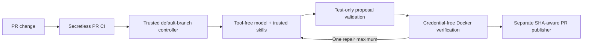

# Solution

This repository adds useful frontend/backend tests and a custom PR test agent. The execution ledger is [docs/IMPLEMENTATION_PLAN.md](docs/IMPLEMENTATION_PLAN.md), and design discussions are recorded in [docs/DECISIONS.md](docs/DECISIONS.md). Shared work rules are in [AGENTS.md](AGENTS.md), with coordinator and specialist responsibilities in [docs/agents](docs/agents).

## Design

The custom agent analyses a PR diff and relevant source/tests, selects reusable skills, and proposes test files as structured JSON. A trusted controller validates proposals and owns the test results; model text cannot declare a run successful. A failed candidate can receive one repair attempt, for at most two generation attempts.



PR source, npm lifecycle scripts, test configuration and generated tests are executable untrusted input. Within the privileged agent workflow they run only in containers without provider or GitHub credentials; test execution has networking disabled. Ordinary PR CI runs on disposable GitHub runners with read-only permissions and no provider secret. Generation uses the Responses API without shell tools, and instructions/skills come from the trusted controller checkout. Results are delivered as a patch artifact and one updated PR comment, preserving contributor control and avoiding recursive commits.

## Agent and skills

- Custom agent instructions: `automation/agent.md`.
- GitHub entrypoint: `automation/run.mjs`; bounded loop: `automation/controller.mjs`; isolated verifier: `automation/verifier.mjs`.
- Reusable skills: `.agents/skills/analyze-test-changes/SKILL.md`, `frontend-unit-tests/SKILL.md`, and `backend-unit-tests/SKILL.md` under the same skills directory.
- The controller loads skill contents into trusted model instructions and records the selected names; skills are operational inputs, not documentation-only files.
- Root `npm test` runs controller, validation, provider, snapshot, verifier and publication contract tests. No root package installation is needed because this tooling uses Node built-ins.
- Existing test files can only be extended while preserving their exact original prefix; new test files are preferred. Source/configuration edits, deletion, unsafe paths and basic skipped/exclusive-test forms are rejected.
- Budgets: two provider attempts, 90 seconds/request, 6,000 output tokens, eight test files up to 32 KB each and 160 KB per proposal. Context is capped at 180 KB; snapshots at 500 regular files/4 MB. Install/test phases have 240/180 second limits.

## Application verification

Use Node.js satisfying both package manifests (at least 22.12) and npm. The application suites do not require a live PostgreSQL instance: repository unit tests mock Prisma I/O; Supertest tests exercise Express in-process through temporary local sockets.

```sh
cd frontend
npm ci
npm test
npm run typecheck
npm run test:coverage
```

Run the same commands from `backend`. Its installation generates the Prisma client. Docker is required for the automated agent's isolated verification, not for the ordinary unit test suites.

| Suite | Tests before → after | Statement coverage | Line coverage |
| --- | --- | --- | --- |
| Frontend | 18 → 37 | 46.42% → 69.04% | 47.68% → 67.54% |
| Backend | 48 → 86 | 30.23% → 96.89% | 33.02% → 97.24% |

Frontend additions cover HTTP response/error/cancellation contracts, React Query mutation cache updates and notice lifetime/cleanup. No production code or coverage exclusions were changed. Backend additions cover route success/validation/missing-resource behavior, app errors/health, configuration and controlled startup/shutdown. Exact commands and all metrics are recorded in [frontend](docs/reports/frontend.md) and [backend](docs/reports/backend.md) reports. Local execution used Node 26.8.2 and npm 11.19.1. The final root contract suite passed **33/33** cases; together with frontend and backend this is **156 passing application/contract cases**. Workflow syntax passed actionlint, and whitespace checks passed. GitHub [CI run 45692900997](https://github.com/Dziemiano/taskly-app-node/actions/runs/45692900997) also passed both application jobs, including typecheck and coverage, and the automation contracts. All three jobs completed successfully, including real Docker fixture verification. [Demo PR CI run 45692977519](https://github.com/Dziemiano/taskly-app-node/actions/runs/45692977519) also passed.

## Example run without an API key

From a committed checkout with Linux, Node.js and accessible Docker:

```sh
npm test
npm run agent:demo
```

The separate [demonstration PR #2](https://github.com/Dziemiano/taskly-app-node/pull/2) carries the overdue feature on `codex/demo-overdue-filter` against `codex/unit-test-agent`. The demo exports the committed application snapshot, applies `automation/fixtures/overdue-feature.patch`, and uses `overdue-proposal.json` as a deterministic provider response. It selects `analyze-test-changes` and `frontend-unit-tests`. The proposed tests cover local-date boundaries, completed/undated exclusions, search/sort composition and the new UI option. An intentionally failing first proposal exercises repair; the second proposal removes that fixture-only failure. Both frontend and backend coverage/typechecks run in real Docker containers for the baseline and candidates.

Outputs are `agent-demo-output/result.json` and, only after successful verification, `agent-demo-output/tests.patch`. The `CI` workflow uploads them as `fixture-agent-demo`. This is **fixture-provider execution, not live model generation**.

The real [GitHub fixture artifact](https://github.com/Dziemiano/taskly-app-node/actions/runs/45692900997/artifacts/15060230453) records `status: verified`, passing baseline, first-attempt install exit 0/test exit 1, then repaired install/test exit 0. The accepted candidate passed 40 frontend and 86 backend tests plus both typechecks. The demo tested merge checkout `baa1be1bc8bb7053621ab833e3b4918e5a166ddd` for PR head `f1dd2d3`; patch SHA-256 is `ec62e4ee0e0e58d6cebfe23f770f1a7f456415bd138d65541546240973d135e6`.

The feature passed the existing 37 frontend tests and typecheck locally. With the fixture tests, 40 tests and typecheck passed. Restoring the old production behavior produced two expected failures: missing UI option and incorrect overdue filtering. Local Docker execution correctly stopped with `baseline_failed` because this machine denies Docker socket access; no local container success is claimed. The owner refreshed the GitHub OAuth workflow permission and both branches were published. Real Docker verification succeeded on GitHub as recorded above; local Docker remains unavailable.

## GitHub activation and results

The complete implementation is published in [PR #1](https://github.com/Dziemiano/taskly-app-node/pull/1), initially at `f1dd2d3`; [PR #2](https://github.com/Dziemiano/taskly-app-node/pull/2), initially at `864fe33`, demonstrates the separate feature diff. The earlier OAuth workflow-scope blocker is resolved, and CI passed for both PRs. Automatic live generation is intentionally not activated in the current no-key delivery. The privileged PR commenter has not run because the workflow has not been merged to the default branch; its identity/staleness/idempotence behavior is covered by contract tests.

1. Review and merge the complete implementation from PR #1 into the repository default branch. The privileged `workflow_run` definition and trusted controller must be present there; merely opening this implementation PR does not activate them.
2. In **Settings → Secrets and variables → Actions**, create repository secret `OPENAI_API_KEY` and repository variable `OPENAI_MODEL` with a model available to the account that supports Responses API structured outputs. The key is used only by the generation step. Never commit it or paste it into PR text.
3. Ensure GitHub Actions is enabled and repository/organization policy permits the publisher's declared issue/PR write permissions. Open or update a same-repository PR with behavioral TypeScript changes.
4. `CI` runs on PR open, synchronization and reopening. Its completion triggers **Unit Test Agent**. Failed CI, forks and missing key/model receive explicit skip statuses. With prerequisites met, the controller verifies baseline, generates or declines tests, and allows one repair.
5. The separate publisher rechecks the current open PR head, updates one bot-owned marker comment, and links the `agent-results` artifact for that workflow run. Reports include decision/rationale, loaded skills, attempts and actual verification results. Obsolete runs cannot overwrite a newer head's comment. When a workflow event omits its PR association, the controller resolves the exact head through GitHub and rejects missing or ambiguous matches.

Download `agent-results`, inspect `result.json`, and apply a verified `tests.patch` against its exact recorded PR head:

```sh
git switch <your-pr-branch>
git rev-parse HEAD                 # must equal result.json head
git apply --check /path/to/tests.patch
git apply /path/to/tests.patch
```

Review the tests and rerun both application suites before committing. The agent publishes a proposal; it does not push to contributor branches or merge PRs. To rerun generation, rerun the PR's CI or update its branch. `npm run agent:run` is the GitHub event entrypoint and requires the workflow environment; use `agent:demo` for local no-key reproduction.

## Publishing the local handoff

The coordinator provides the complete local history in `../taskly-solution.bundle` beside this checkout. To recover it elsewhere, use `git clone --branch codex/unit-test-agent /path/to/taskly-solution.bundle taskly-solution`, then set that clone's origin to your GitHub repository. To publish a recovered checkout to another authorized repository, ensure authentication permits workflow updates and push both branches:

```sh
gh auth refresh -h github.com -s workflow
git push -u origin codex/unit-test-agent codex/demo-overdue-filter
```

Both branches and PRs are already published in this repository. PR #1 tracks the implementation branch; PR #2 targets it so reviewers can inspect only the feature diff. The privileged agent still requires default-branch activation described above. Retain the `CI` fixture artifact after a successful real Docker run; do not confuse fixture-provider success with live model generation.

## Assumptions and limitations

- Automatic generation targets trusted same-repository PRs. A fork-safe generation service is a production extension.
- Append-only validation preserves existing test text, but cannot prove useful assertions or exclude all JavaScript tricks. PR-controlled configuration can affect test intent. Verified means the observed baseline/candidate commands passed; human review is required.
- Containers reduce credential exposure; they are not a substitute for stronger isolation against hostile kernel exploits. A production service should use disposable isolated workers and controlled package-registry access.
- Passing mocked unit tests cannot establish real database, browser or deployment correctness. Those require separate integration/end-to-end coverage.
- Live model generation is outside the user-approved no-key verification scope. Reports distinguish local tests, fixture-provider tests, real container execution and GitHub runs.

Production improvements would include a representative agent evaluation dataset, stronger worker isolation, dependency/network controls, per-repository spend quotas, richer traces and coverage of changed behavior, and a reviewed opt-in path for fork contributions.
