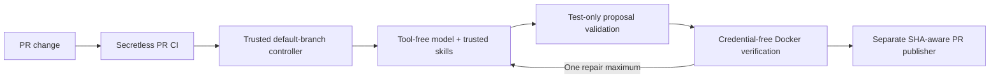

# Solution

This repository adds useful frontend/backend tests and a custom PR test agent. The execution ledger is [docs/IMPLEMENTATION_PLAN.md](docs/IMPLEMENTATION_PLAN.md), and design discussions are recorded in [docs/DECISIONS.md](docs/DECISIONS.md).

## Design

The custom agent analyses a PR diff and relevant source/tests, selects reusable skills, and proposes test files as structured JSON. A trusted controller validates proposals and owns the test results; model text cannot declare a run successful. A failed candidate can receive one repair attempt, for at most two generation attempts.



PR source, npm lifecycle scripts, test configuration and generated tests are executable untrusted input. They run only in containers without provider or GitHub credentials. Test execution has networking disabled. Generation uses the Responses API without shell tools, and instructions/skills come from the trusted controller checkout. Results are delivered as a patch artifact and one updated PR comment, preserving contributor control and avoiding recursive commits.

## Agent and skills

- Custom agent instructions: `automation/agent.md`.
- Controller: `automation/run.mjs`.
- Reusable skills: `.agents/skills/analyze-test-changes/SKILL.md`, `frontend-unit-tests/SKILL.md`, and `backend-unit-tests/SKILL.md` under the same skills directory.
- The controller loads skill contents into trusted model instructions and records the selected names; skills are operational inputs, not documentation-only files.
- Root `npm test` runs controller contract tests. `npm run agent:demo` runs deterministic fixture responses against real Docker verification. It requires a working Docker daemon and package-registry access for installation.

## Application verification

Use Node.js satisfying both package manifests (at least 22.12) and npm. The application suites do not require a live PostgreSQL instance: repository unit tests mock Prisma I/O; Supertest tests exercise Express in-process through temporary local sockets.

```sh
cd frontend
npm ci
npm test
npm run typecheck
npm run test:coverage
```

Run the same commands from `backend`. Its installation generates the Prisma client. Docker is required for the automated agent's isolated verification, not for the ordinary unit test suites.

| Suite | Tests before → after | Statement coverage | Line coverage |
| --- | --- | --- | --- |
| Frontend | 18 → 37 | 46.42% → 69.04% | 47.68% → 67.54% |
| Backend | 48 → 86 | 30.23% → 96.89% | 33.02% → 97.24% |

Frontend additions cover HTTP response/error/cancellation contracts, React Query mutation cache updates and notice lifetime/cleanup. No production code or coverage exclusions were changed. Backend additions cover route success/validation/missing-resource behavior, app errors/health, configuration and controlled startup/shutdown. Exact commands and all metrics are recorded in [frontend](docs/reports/frontend.md) and [backend](docs/reports/backend.md) reports. Local execution used Node 26.8.2 and npm 11.19.1.

## Demonstration feature

A small overdue-status filter is prepared as a separate feature patch for a demonstration PR. It extends the existing status selector and reuses local calendar-date overdue semantics. Its deterministic fixture proposes tests for past/today/future dates, completed and undated exclusions, search/sort composition, and UI selection.

The feature passed the existing 37 frontend tests and typecheck locally. Applying the fixture tests passed 40 tests and typecheck. Restoring the old production behavior produced two expected failures: the missing UI option and incorrect overdue filtering. This is useful regression evidence from a fixture response; no live model generated these tests.

## Activation and evidence scope

The current delivery deliberately requires no API key. Deterministic provider fixtures must be described as fixtures; they demonstrate controller decisions and verification behavior, not the quality of live model generation. Real model execution requires repository secret `OPENAI_API_KEY` and explicit `OPENAI_MODEL` configuration. Never paste the key into source, an issue or a PR comment.

The trusted `workflow_run` controller must exist on the repository default branch before automatic PR handling becomes active. An implementation PR alone does not activate that workflow. This delivery does not authorize an automatic merge. Fork PRs must not receive provider credentials; their supported/skip status is reported explicitly.

## Assumptions and limitations

- Automatic generation targets trusted same-repository PRs. A fork-safe generation service is a production extension.
- JSON and path validation constrain file destinations, but cannot prove that an assertion is useful. Generated tests and patches still require human review.
- Containers reduce credential exposure; they are not a substitute for stronger isolation against hostile kernel exploits. A production service should use disposable isolated workers and controlled package-registry access.
- Passing mocked unit tests cannot establish real database, browser or deployment correctness. Those require separate integration/end-to-end coverage.
- Live model generation is outside the user-approved no-key verification scope. Reports distinguish local tests, fixture-provider tests, real container execution and GitHub runs.

Production improvements would include a representative agent evaluation dataset, stronger worker isolation, dependency/network controls, per-repository spend quotas, richer traces and coverage of changed behavior, and a reviewed opt-in path for fork contributions.
